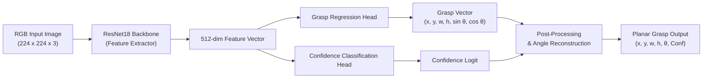

# NeuroGrasp System Architecture

## 1. High-Level Pipeline

The NeuroGrasp system takes a 2D RGB image as input and directly predicts 2D planar grasp parameters in real-time.

---

## 2. Neural Network Architecture

### Backbone
- **Base**: ResNet18 (ImageNet pretrained or custom initialized)
- **Layer Output**: 512 channels from adaptive average pooling layer (`fc` layer removed)

### Dual Heads

1. **Grasp Regression Head**:
   - `Linear(512, 256) -> BatchNorm1d -> ReLU -> Dropout(0.2)`
   - `Linear(256, 64) -> ReLU`
   - `Linear(64, 6)`
   - Output: Normalized $(x_{norm}, y_{norm}, w_{norm}, h_{norm}, \sin\theta, \cos\theta)$

2. **Confidence Classification Head**:
   - `Linear(512, 128) -> ReLU -> Dropout(0.2)`
   - `Linear(128, 1)`
   - Output: Unnormalized logit score $\sigma(z) \in [0.0, 1.0]$

---

## 3. Input & Target Normalization

All spatial parameters are mapped relative to input tensor dimensions $(W, H)$:

$$\begin{aligned}
x_{norm} &= \frac{x}{W} \\
y_{norm} &= \frac{y}{H} \\
w_{norm} &= \frac{w}{W} \\
h_{norm} &= \frac{h}{H} \\
\sin\theta &= \sin(\theta_{rad}) \\
\cos\theta &= \cos(\theta_{rad})
\end{aligned}$$

At inference time, the angle is reconstructed unambiguously using $\theta = \text{atan2}(\sin\theta, \cos\theta)$.
